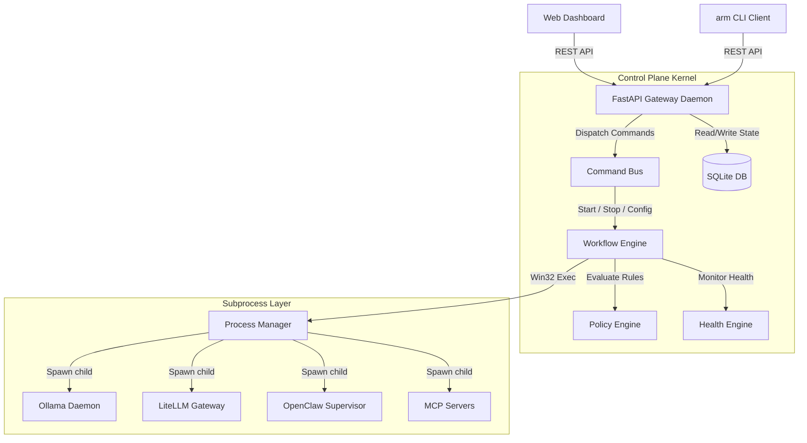
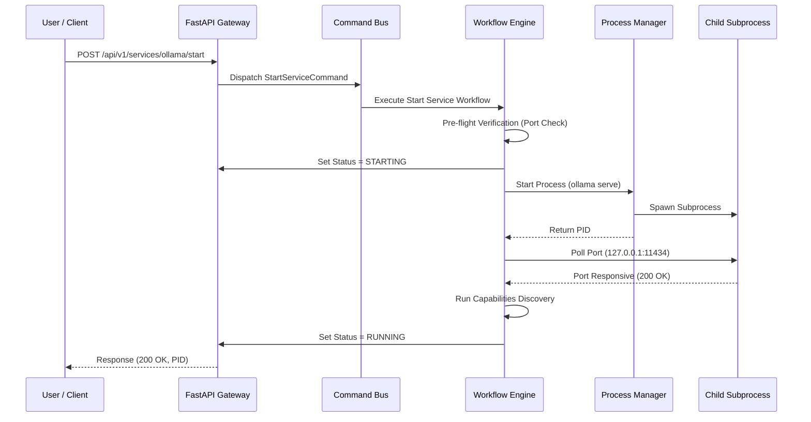

# ForgeOps Architecture Guide

This document describes the software architecture, core components, and data flow of the ForgeOps (AI Runtime Manager) platform.

---

## 1. High-Level System Topology

ForgeOps runs as a localized background service wrapper on Windows. The core architecture contains five critical software layers:
1. **Developer Client Interfaces**: The React Web Dashboard (port `8088`), the `arm` CLI client, and external editor agents.
2. **REST API Gateway**: A FastAPI web server (port `8088`) running in a Windows Service wrapper.
3. **Control Plane Kernel**: The logical brain (`ControlPlaneKernel`) coordinating commands, events, and configuration tables.
4. **SQLite Persistence Layer**: A single DB file (`arm.db`) storing service definitions, capabilities, and system configurations.
5. **Plugin & Runtime Layer**: Child processes (Ollama, LiteLLM, OpenClaw, MCP) spawned by the process manager.

---

## 2. Core Components

### A. The Control Plane Kernel (`ControlPlaneKernel`)
The kernel initializes registries and acts as the runtime bus. It binds together:
* **Service Registry**: Keeps track of active plugins and maps identifiers (e.g., `ollama` -> `OllamaPlugin`).
* **Capability Registry**: Manages model inventories discovered from local runtimes.
* **Command Bus & Event Bus**: Dispatches transactional requests (e.g. `StartServiceCommand`) and publishes status notifications (e.g. `HealthChangedEvent`).

### B. The Workflow Engine
Subprocess launches are managed using a transactional workflow engine. If any step fails, the engine rolls back the preceding actions.

#### Service Startup Steps:
1. **Pre-flight Verification**: Checks platform OS support, binary executable existence in path, and TCP port availability.
2. **Update Status (STARTING)**: Sets service state in SQLite.
3. **Launch Subprocess**: Spawns the executable using the Process Manager, tracking stdout/stderr files and the child process PID.
4. **Wait for Port**: Polls the plugin's API until the target port is responsive. Times out after 5.0 seconds.
5. **Capabilities Discovery**: Triggers a capability check to sync the model registry.
6. **Update Status (RUNNING)**: Finalizes state in SQLite and fires a `ServiceStartedEvent`.

### C. The Policy Engine
Evaluates structural rules before command execution and intercepts health shifts:
* **Manual Command Interception**: Stops and starts reset failure counts and clear retry history records.
* **Auto-Restart & Exponential Backoff**: If a service crashes unexpectedly, the engine schedules a retry with the following backoff delay:
  $$\text{Delay} = \text{base\_delay} \times (\text{multiplier}^{\text{attempt} - 1}) \pm \text{jitter}$$
* **Circuit Breaker**: If failures exceed `auto_restart_limit`, the breaker shifts to `OPEN`, preventing CPU thundering loops.

---

## 3. Data Flow Diagrams

### Service Lifecycle: Start Execution Sequence
The diagram below details the step-by-step transaction flow during a runtime start action:

---

## 4. SQLite Database Schema

The persistence layer defines the following data models:

1. **`services`**: Unique ID, service name, port, status (`STOPPED`, `STARTING`, `RUNNING`, `ERROR`), PID, binary path, configuration arguments, and auto-start properties.
2. **`models`**: Catalog of discovered capabilities, storing size in bytes, parameter count, family (e.g., `llama`), and provider (`ollama` or `litellm`).
3. **`performance_metrics`**: Chronological metrics repository tracking execution speed (tokens/sec) and host load (CPU, RAM, GPU, VRAM).
4. **`system_config`**: Stores policy settings, auto-restart limits, and current software version numbers.
5. **`system_inventory`**: Logs host workstation details (CPU, OS version, GPU model).
6. **`operational_history`**: Audit trail of control plane actions and health notifications.
