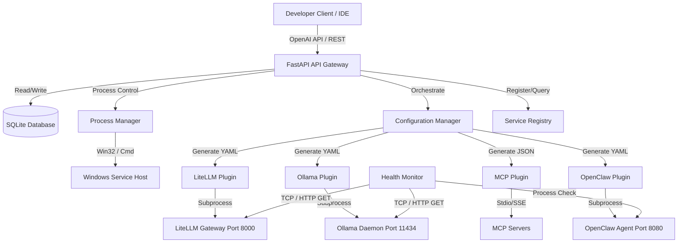

# Technical Architecture Document: AI Runtime Manager

This document details the software architecture, data models, process management model, database schema, and integration contracts for the AI Runtime Manager on Windows 11 Professional.

## System Topology

AI Runtime Manager runs as a background Windows Service wrapping a FastAPI backend and SQLite database. It communicates with plugins (Ollama, LiteLLM, OpenClaw, MCP) over local TCP loops, dynamically reading configuration inputs, updating state tables, and directing host processes.



## Database Schema (SQLite)

We use SQLite for local persistence, housing configurations, service statuses, discovered models, and metrics.

### Service Registry Table (`services`)
Tracks all onboarded local AI components.
```sql
CREATE TABLE services (
    id TEXT PRIMARY KEY,
    name TEXT NOT NULL UNIQUE,
    type TEXT NOT NULL,          -- 'ollama', 'litellm', 'openclaw', 'mcp', etc.
    port INTEGER UNIQUE,
    status TEXT NOT NULL,        -- 'STOPPED', 'STARTING', 'RUNNING', 'DEGRADED', 'ERROR'
    pid INTEGER,
    binary_path TEXT,
    args TEXT,                   -- JSON list of command-line arguments
    config_path TEXT,
    auto_start INTEGER DEFAULT 1,
    created_at TIMESTAMP DEFAULT CURRENT_TIMESTAMP,
    updated_at TIMESTAMP DEFAULT CURRENT_TIMESTAMP
);
```

### Models Table (`models`)
Dynamically populated database of local models discovered by runtime plugins.
```sql
CREATE TABLE models (
    id TEXT PRIMARY KEY,
    name TEXT NOT NULL,
    provider TEXT NOT NULL,      -- 'ollama', 'litellm'
    type TEXT NOT NULL,          -- 'embedding', 'vision', 'reasoning', 'coding', 'general'
    size_bytes INTEGER,
    family TEXT,
    parameter_size TEXT,
    meta_json TEXT,              -- JSON metadata (e.g., quantizations, context length)
    last_discovered TIMESTAMP DEFAULT CURRENT_TIMESTAMP,
    UNIQUE(name, provider)
);
```

### Metrics Table (`performance_metrics`)
A time-series table tracking response latency and request counts.
```sql
CREATE TABLE performance_metrics (
    id INTEGER PRIMARY KEY AUTOINCREMENT,
    service_id TEXT,
    timestamp TIMESTAMP DEFAULT CURRENT_TIMESTAMP,
    request_path TEXT,
    response_time_ms INTEGER,
    status_code INTEGER,
    vram_used_bytes INTEGER,
    gpu_utilization_pct REAL,
    cpu_utilization_pct REAL,
    ram_used_bytes INTEGER,
    FOREIGN KEY(service_id) REFERENCES services(id)
);
```

### Configuration Table (`system_config`)
Key-value configuration store for the orchestrator.
```sql
CREATE TABLE system_config (
    key TEXT PRIMARY KEY,
    value TEXT NOT NULL,
    updated_at TIMESTAMP DEFAULT CURRENT_TIMESTAMP
);
```

## Process Management Model

Since AI Runtime Manager must run persistently on Windows, we use a hybrid process management model:

1. **Windows Service Wrapper**: The core FastAPI app runs inside a Windows Service wrapper (implemented via Python's `win32serviceutil` package or wrapped by `NSSM`).
2. **Subprocess Management**: The Process Manager module monitors and launches child runtimes (Ollama daemon, LiteLLM, OpenClaw, MCP). It handles stdout/stderr redirection, captures PIDs, and terminates processes cleanly using `psutil`.
3. **Graceful Termination**: On shutdown, the Process Manager sends `SIGINT` (or uses `taskkill /pid {pid}`) to child processes, preventing orphaned "zombie" processes.

## Plugin Framework

The Plugin Framework enables zero-core-modification integration for new runtimes. Every runtime must implement the `RuntimePlugin` interface.

```python
from abc import ABC, abstractmethod
from typing import Dict, Any, List

class RuntimePlugin(ABC):
    @abstractmethod
    def get_identifier(self) -> str:
        """Returns the unique plugin identifier (e.g. 'ollama')."""
        pass

    @abstractmethod
    def discover_models(self) -> List[Dict[str, Any]]:
        """Dynamically query the runtime host and return available models."""
        pass

    @abstractmethod
    def generate_config(self, global_config: Dict[str, Any]) -> str:
        """Generate the YAML/JSON configuration content for the target runtime."""
        pass

    @abstractmethod
    def get_health(self) -> Dict[str, Any]:
        """Perform health validation (ports, process state, API responses)."""
        pass
```
