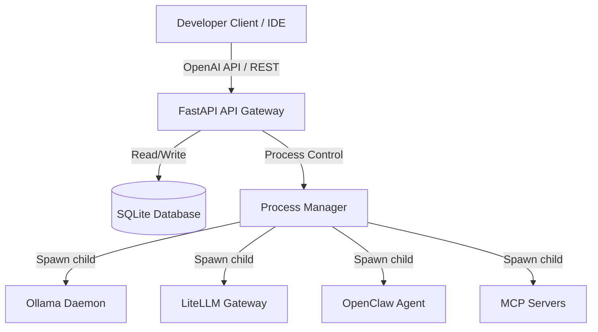

# ForgeOps (AI Runtime Manager) Wiki

Welcome to the official technical wiki for **ForgeOps** (AI Runtime Manager)! 

ForgeOps is an enterprise-grade local AI orchestration and control plane platform designed to manage and monitor heterogeneous AI runtimes on Windows workstations. It automates process lifecycle, configuration synthesis, health evaluation, and resource monitoring for local AI tools: Ollama, LiteLLM, OpenClaw, and Model Context Protocol (MCP) servers.

## Documentation Roadmap

Use the sidebar navigation or the direct links below to explore the documentation:

### Core Guides
* **[[Quick Start]]**: Get ForgeOps up and running in under 10 minutes.
* **[[Installation Guide]]**: Complete prerequisites, installation parameters, and post-installation verification checks.
* **[[User Guide]]**: Daily operational tasks using the CLI and Web Dashboard.
* **[[Administrator Guide]]**: Hardened security policies, Windows Service configurations, and system directory tuning.

### Component References
* **[[Dashboard Guide]]**: A complete walkthrough of the Vite + React Web Dashboard and tabs.
* **[[CLI Guide]]**: Interactive CLI commands for the `arm` command line tool.
* **[[REST API]]**: Complete FastAPI gateway REST endpoint specifications.
* **[[Plugin SDK]]**: Abstract `RuntimePlugin` developer guide for custom extensions.
* **[[Configuration]]**: Configuration syntax for `arm-config.yaml`, `litellm_config.yaml`, and `openclaw_config.yaml`.

### Operations & Maintenance
* **[[Workflows]]**: Lifecycle sequence diagrams for startup, port checks, and capabilities discovery.
* **[[Policies]]**: Auto-restart backoffs, circuit breakers, and active session protection thresholds.
* **[[Diagnostics]]**: Quick troubleshooting telemetry, metrics table, and support bundle handling.
* **[[Troubleshooting]]**: Symptom-to-resolution recovery procedures.
* **[[Operations Manual]]**: Scheduled SRE maintenance routines.
* **[[Security Guide]]**: Local security sandbox details, NTFS DACLs, and API key management.

### Project Resources
* **[[FAQ]]**: Answers to frequently asked questions.
* **[[Release Notes]]**: Feature highlights and known limitations for Version 1.0.0.
* **[[Glossary]]**: Terminology definitions.
