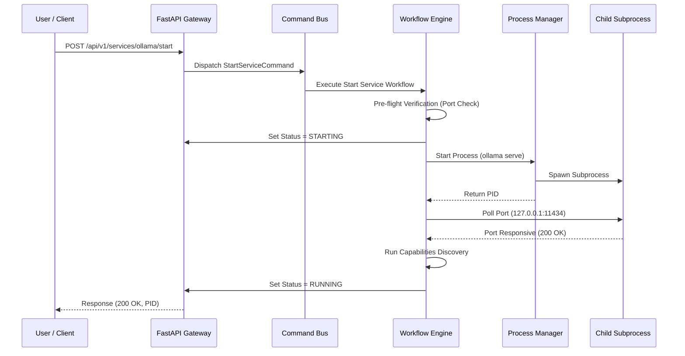

# ForgeOps Core Workflows

This document details the software execution workflows, startup sequence, and command dispatch transactions.

### B. The Workflow Engine
Subprocess launches are managed using a transactional workflow engine. If any step fails, the engine rolls back the preceding actions.

#### Service Startup Steps:
1. **Pre-flight Verification**: Checks platform OS support, binary executable existence in path, and TCP port availability.
2. **Update Status (STARTING)**: Sets service state in SQLite.
3. **Launch Subprocess**: Spawns the executable using the Process Manager, tracking stdout/stderr files and the child process PID.
4. **Wait for Port**: Polls the plugin's API until the target port is responsive. Times out after 5.0 seconds.
5. **Capabilities Discovery**: Triggers a capability check to sync the model registry.
6. **Update Status (RUNNING)**: Finalizes state in SQLite and fires a `ServiceStartedEvent`.

## 3. Data Flow Diagrams

### Service Lifecycle: Start Execution Sequence
The diagram below details the step-by-step transaction flow during a runtime start action:

---
